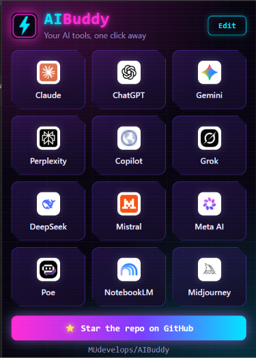
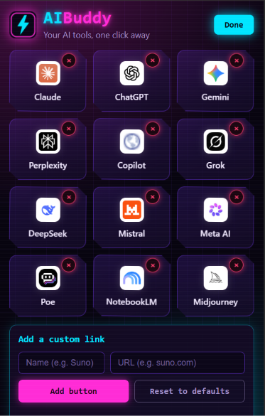
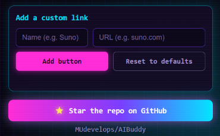

<div align="center">



<br/>


[](https://youtu.be/oDpTu_NPVdI)
[](https://github.com/MUdevelops/AIBuddy/stargazers)


**[Overview](#overview)** • **[Watch](#video)** • **[Features](#features)** • **[Screenshots](#screenshots)** • **[Install](#install)** • **[Usage](#usage)** • **[Customize](#customize)** • **[Roadmap](#roadmap)** • **[FAQ](#faq)**

</div>

<a id="overview"></a>


**AIBuddy** is a neon, cyberpunk-styled Chrome extension that puts every AI tool you use behind one icon. Click the icon, see your buttons, press one. Claude, ChatGPT, Gemini and more open in a new tab instantly. No typing, no bookmarks folder, no signup.

> Your AI tools, one click away.

<a id="video"></a>


<div align="center">

<a href="https://youtu.be/oDpTu_NPVdI">
  
</a>

**[▶ Watch the AIBuddy video on YouTube](https://youtu.be/oDpTu_NPVdI)**

</div>

<a id="features"></a>


- 🚀 **One-click launch** - every AI tool is a single button in the popup
- ➕ **Add custom links** - type a name and a URL, and a new button appears
- ➖ **Remove anything** - press **Edit** and tap the × on any button
- 🔁 **Reset to defaults** - restore the original tool list at any time
- 🌐 **Sync across devices** - your list follows your Chrome profile
- 🎨 **Cyberpunk UI** - pink and blue neon glow, scanlines, angled tiles
- 🔒 **Private by design** - no account, no analytics, no external server
- ⌨️ **Keyboard friendly** - visible focus states and Enter-to-add

<a id="screenshots"></a>


<div align="center">



</div>

The slideshow shows one screen at a time:

| Screen | What it shows |
| --- | --- |
| **Main dashboard** | Every AI tool in one place. No signup required. |
| **Edit mode** | Adding and removing links right from the popup. |
| **Add custom links** | Creating your own button with a name and a URL. |

<details>
<summary><b>View each screenshot on its own</b></summary>
<br/>

**Main dashboard**



**Edit mode**



**Add custom links**



</details>

<a id="tools"></a>


These buttons come built in. You can remove any of them or add your own.

| Tool | Link |
| --- | --- |
| Claude | https://claude.ai |
| ChatGPT | https://chatgpt.com |
| Gemini | https://gemini.google.com |
| Perplexity | https://www.perplexity.ai |
| Copilot | https://copilot.microsoft.com |
| Grok | https://grok.com |
| DeepSeek | https://chat.deepseek.com |
| Mistral | https://chat.mistral.ai |
| Meta AI | https://www.meta.ai |
| Poe | https://poe.com |
| NotebookLM | https://notebooklm.google.com |
| Midjourney | https://www.midjourney.com |

<a id="install"></a>


AIBuddy loads as an unpacked extension, so you can install it in under a minute.

1. **Download** the code: click **Code → Download ZIP**, or run:
   ```bash
   git clone https://github.com/MUdevelops/AIBuddy.git
   ```
2. Open `chrome://extensions` in Chrome (also works in Edge, Brave and other Chromium browsers).
3. Turn on **Developer mode** (top right).
4. Click **Load unpacked** and select the `AIBuddy` folder.
5. Pin it with the puzzle-piece menu so the icon stays in your toolbar.

<a id="usage"></a>


1. Click the **AIBuddy** icon in your toolbar.
2. Press any button. The tool opens in a new tab and the popup closes.

That is the whole workflow.

<a id="customize"></a>


**Add a button**
1. Press **Edit** in the popup.
2. Enter a name (for example `Suno`) and a link (for example `suno.com`).
3. Press **Add button** or hit Enter. A missing `https://` is added for you.

**Remove a button**
1. Press **Edit**.
2. Tap the **×** on the tile you want gone.
3. Press **Done**.

**Start over**
Press **Reset to defaults** in Edit mode to bring back the original list.

<a id="privacy"></a>


| Question | Answer |
| --- | --- |
| Do I need an account? | No |
| Does it collect data? | No |
| Does it talk to a server? | No server of its own |
| Permissions requested | `storage` only, to save your button list |
| Where is my list stored? | In your Chrome profile (`chrome.storage.sync`) |

Tool logos are loaded from Google's public favicon service. If a logo cannot load, AIBuddy shows a neon letter instead.

<a id="stack"></a>


- **Chrome Extension Manifest V3**
- **HTML5 + CSS3** - custom neon theme, no framework
- **Vanilla JavaScript** - no build step, no dependencies
- **Chrome Storage API** - saves your links

<a id="structure"></a>


```text
AIBuddy/
├── manifest.json            # Extension config (MV3)
├── popup.html               # Popup layout
├── popup.css                # Cyberpunk neon styling
├── popup.js                 # Buttons, add/remove, storage
├── icons/                   # 16, 32, 48, 128 px icons
├── assets/
│   ├── banner.svg           # Animated README header
│   ├── marquee.svg          # Scrolling tool strip
│   ├── preview.svg          # Screenshot slideshow
│   ├── cta.svg              # Animated star button
│   ├── headers/             # Animated section titles
│   └── screenshots/         # Main.png, Edit.png, Add.png
└── tools/
    └── make_slideshow.py    # Rebuilds preview.svg from your screenshots
```

<a id="roadmap"></a>


- [x] One-click AI tool buttons
- [x] Add, remove and reset links
- [x] Neon cyberpunk popup
- [ ] Drag-to-reorder buttons
- [ ] Search box to filter tools
- [ ] Keyboard shortcut to open the popup
- [ ] Button groups (chat, image, code, research)
- [ ] Export and import your link list
- [ ] Chrome Web Store release

<a id="contributing"></a>


Ideas and pull requests are welcome.

1. Fork the repo
2. Create a branch: `git checkout -b feature/my-idea`
3. Commit your changes: `git commit -m "Add my idea"`
4. Push the branch and open a pull request

Found a bug or want a new default tool? [Open an issue](https://github.com/MUdevelops/AIBuddy/issues).

<a id="faq"></a>


<details>
<summary><b>Does it work in other browsers?</b></summary>
<br/>
Yes, in Chromium-based browsers such as Edge, Brave and Opera. Load it the same way from the extensions page.
</details>

<details>
<summary><b>Why did my buttons disappear?</b></summary>
<br/>
Open the popup, press <b>Edit</b>, then <b>Reset to defaults</b>.
</details>

<details>
<summary><b>Can I add any website, not just AI tools?</b></summary>
<br/>
Yes. Any <code>http</code> or <code>https</code> link works.
</details>

<details>
<summary><b>Do I need to sign in to anything?</b></summary>
<br/>
No. AIBuddy never asks for an account.
</details>

<a id="license"></a>


Released under the MIT License. Add a `LICENSE` file to the repo to make it official.

<a id="support"></a>


<div align="center">

If AIBuddy saves you clicks, a star helps other people find it.

<a href="https://github.com/MUdevelops/AIBuddy"></a>

<br/>


Made with neon by **[MUdevelops](https://github.com/MUdevelops)**

</div>
